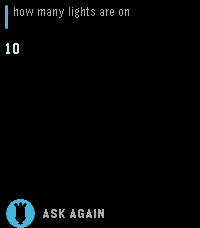
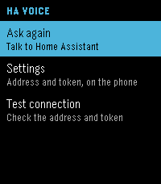

# HA Voice

<https://github.com/Aulos/pebble-ha-voice>

Ask Home Assistant from a Pebble Time 2. Press the middle button, say what you
want, and read the answer on the watch. There is no voice output: the reply is
text only, which is what a watch with no speaker can do well.

| Main | Answer | Menu |
| --- | --- | --- |
|  |  |  |

## What it does

- **Main screen**: a microphone in the classic Pebble dictation style. Tap it or
  press SELECT to start listening.
- **Answer screen**: the question at the top, the reply below it in a scrolling
  area, and an ASK AGAIN footer. Tap the footer, press UP, or press BACK.
- **Menu**: press DOWN or swipe down. It has *Ask again*, *Settings* and
  *Test connection*.
- **Settings** are typed on the phone, never on the watch: the Home Assistant
  address and a long-lived access token. The watch has no keyboard, and a token
  is too long to enter with buttons.

Everything works with buttons and, on the Time 2, with touch.

## Requirements

- A Pebble Time 2 (`emery`). The app also builds for `basalt` and `flint`, the
  other platforms with a microphone; those have no touchscreen, so the buttons
  are the only input there.
- Home Assistant reachable from the phone, with the Assist conversation API.
- A long-lived access token: in Home Assistant, open your profile, go to
  Security, and create one under *Long-lived access tokens*.

## Build and install

```sh
uv tool install pebble-tool
pebble sdk install latest

pebble build
pebble install --phone <phone-ip>     # to a real watch
pebble install --emulator emery       # to the emulator
```

## Set it up

Everything is entered on the phone. There are two ways to open the settings
page, and both open the same page on the phone:

1. **From the Pebble app, without touching the watch**: open the Pebble app on
   the phone, go to *HA Voice*, and choose *Settings*.
2. **From the watch**: press DOWN on the main screen and choose *Settings*. The
   watch only asks the phone to open the page; nothing is typed on the watch.

Enter the address (for example `http://homeassistant.local:8123`, with the port)
and paste the token, then save. The page is stored inside the app and loaded
from the phone, so there is nothing to host.

The watch shows **NOT SET UP** until both are set.

To check them, press DOWN on the main screen and choose *Test connection*. The
watch shows *Connected to Home Assistant.*, or the reason it failed, such as
*Token rejected (401)*. The test runs on the phone, because Home Assistant does
not send the CORS headers that a browser page would need.

## How it fits together

The watch does not talk to the network. It sends the question to the phone over
AppMessage, and the phone's JavaScript posts it to Home Assistant:

```
watch (C)                     phone (JS)                    Home Assistant
---------                     ----------                    --------------
dictation  --AppMessage-->  ha.js  --POST /api/conversation/process-->
answer     <--AppMessage--        <--response.speech.plain.speech-----
```

Both directions are chunked at 180 bytes per message, so a long transcription
and a long answer are not limited by the size of one AppMessage. The phone sends
one chunk at a time and waits for the watch to acknowledge it, because a burst
overflows the AppMessage queue. The watch keeps up to 1024 bytes of the reply
and ends a longer one with `...`.

| File | Purpose |
| --- | --- |
| `src/c/main_window.c` | Microphone screen, state text, hints, touch and buttons |
| `src/c/answer_window.c` | Answer screen: question header, scrolling reply, footer |
| `src/c/menu_window.c` | Watch menu: ask again, settings |
| `src/c/assistant.c` | One request end to end: dictation, transport, states |
| `src/c/comm.c` | Chunked AppMessage transport |
| `src/c/gesture.c` | Turns raw touch events into taps and pans |
| `src/c/mic_icon.c` | The microphone glyph, drawn with vector calls |
| `src/pkjs/ha.js` | Home Assistant calls, chunking, error messages |
| `src/pkjs/settings.js` | Address and token, kept in `localStorage` |
| `src/pkjs/settings-page.js` | The settings page, built as a data URL |
| `scripts/mock-ha.py` | A stand-in Assist API for testing without Home Assistant |
| `scripts/make-icons.py` | Draws the menu and app icons |
| `scripts/emu.sh` | Emulator helpers: install, launch, screenshot, button |

## Testing without Home Assistant

```sh
python3 scripts/mock-ha.py --port 8123 --token test-token -v
```

Then set the address to `http://localhost:8123` and the token to `test-token`.
It answers on the words `kitchen`, `temperature`, `hello`, and `long` (a reply
long enough to need several chunks). `verylong` returns about 1700 characters,
which the watch cuts at 1024 and marks with `...`.

In the emulator, dictation comes from `pebble transcribe`:

```sh
pebble transcribe "turn on the kitchen light" --emulator emery
pebble emu-button click select --emulator emery
```

The settings page can be opened in the emulator with `pebble emu-app-config`;
it is served over HTTP and takes a `return_to` parameter, which is how the page
knows to hand its values back to the emulator instead of to a phone.
